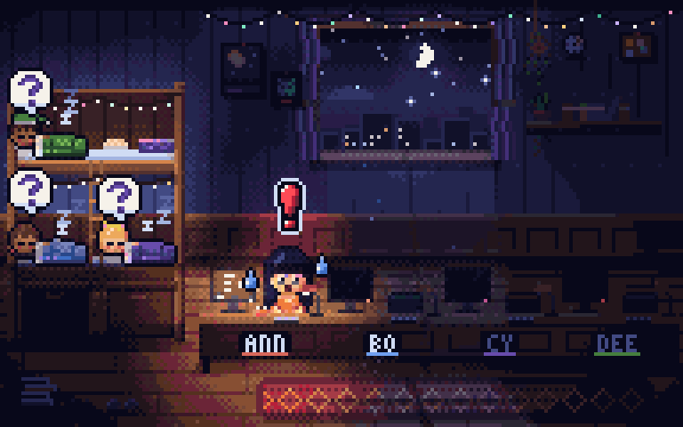

# 谁还没睡 · WhoNotSleep

> 你在电脑前一打开 AI（Claude Code / Codex / Gemini / Cursor / Aider / ChatGPT…），朋友们手机桌面上的像素小人就会坐到你的工位上，显示器亮起，屏幕里的 AI 小精灵开始蹦跶。
> 说了晚安、过了 12 点又偷偷开 AI？你头上冒出大红 **!**，所有睡着的人头上冒出大大的 **?**



## 组成

| 目录 | 说明 |
|---|---|
| `cli/` | Mac 小命令 `wns`：检测 AI 进程 + 空闲状态，自动上报 |
| `server/` | Node 20 + WebSocket 服务，同时渲染桌面组件 PNG |
| `shared/` | 协议 + 纯 JS 8-bit 逐像素光照渲染器（App / 组件 / 服务器共用） |
| `app/` | React Native (Expo SDK 58) App + Android 桌面组件 + iOS WidgetKit 组件 |

服务器：`https://wns.168-231-73-244.sslip.io`

## Mac 上使用

```bash
# 在 App 里「连接电脑」拿到 6 位配对码
npx -y github:Shiyao-Huang/whonotsleep link ABC123
npm i -g github:Shiyao-Huang/whonotsleep   # 之后就有 wns 命令
wns install          # 开机后台自动运行
wns hook install     # 可选：Claude Code 状态秒同步
wns gn               # 晚安 🌙
wns status
```

## 文档 · Docs

- [电脑端后台服务说明 · Mac agent guide](docs/MAC_AGENT.md)（不需要辅助功能/输入监控等任何系统权限）
- [公共 API · Public API](docs/API.md)
- [设计 · Design](docs/DESIGN.md)

## 开发

```bash
node shared/preview.mjs          # 渲染预览到 shared/previews/
cd server && node --test test.mjs
cd app && npx expo run:android   # 或 run:ios
```

AI：App 内置「AI 助手」，模型可调用工具操作整个 App（换造型、晚安、表情、配对电脑…）。服务器提供的模型 Key 只在服务器环境变量里，App 和仓库里都没有。（设置里也可以选填自己的 Anthropic Key：只存在本机 SecureStore，直接请求 api.anthropic.com。）
